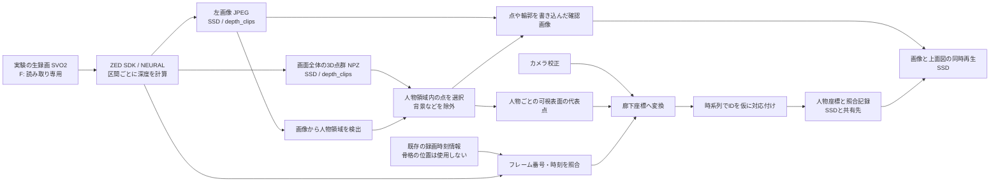

# 深度解析の流れと保存容量

## 現在の流れ



深度処理は69フレームずつ。各区間で録画全体をSDKで読み、該当区間の画像と点を保存する。人物位置は骨格位置を使わない。代表点は見えている表面の候補であり、足元や身体中心ではない。IDと校正は暫定。

## 何を保存しているか

| 場所 | 内容 | 用途 |
|---|---|---|
| F: の元録画 | SVO2映像と録画データ | 元データ。読み取り専用 |
| G: `depth_clips` | 区間ごとの点群NPZ、画像JPEG、SDKカメラ情報、時刻、ハッシュ、ログ | 深度の再評価・人物領域の再計算。点群が特に大きい |
| G: `analysis/<録画>/part_*` | 区間ごとの人物マスク、点と輪郭を描いた画像、人物結果 | 区間ごとの解析・検証 |
| G: `analysis/<録画>/merged` | 全区間を結合した人物結果、マスクと確認画像、HTML再生 | ID追跡と録画・上面図の再生。partの画像やマスクが重複 |
| G: `coordinates` と共有先 | 各時刻の人物位置・暫定ID・品質理由・ハッシュ | 軌跡、ID再割当て候補、上面図。共有先は座標のみ |
| G: `benchmarks` 等 | 速度比較のために別々に処理した点群や人物結果 | 測定結果の根拠。繰り返し分の容量を使う |
| G: 実行環境 | モデル、Python環境、プログラム、校正・時刻 | 再処理、内容の検証 |

点群が大きいのは、人物だけでなく画面全体の多くの画素について、カメラ座標のX・Y・Zとフレーム対応を保存するため。グループ３・018の最初の90フレームでは点群の圧縮NPZが約402 MB、確認用画像が別にある。グループ２・001〜018の6,663フレームをこの例で換算すると、点群だけで約30 GB。実データの点数と圧縮率によって変わる。

## 保存を小さくする方式

別途用意した `compact_depth_results.py` は、完了済みの録画から、**結合後の人物結果・マスク・点を描いた確認画像１組・人物座標・時刻照合・校正・SDKの区間ログやメタデータ・再生HTML** を新しいフォルダへ複製し、各ファイルのハッシュとフレーム時刻を検証する。区間ごとの重複コピー、点群、元画像、速度テストの複製は含めない。元のSVO2のパスとハッシュも記録する。SSD内の新しい `depth_replay_index.html` はWindowsとUbuntuでそのまま開け、再生時にSDKやSVOを必要としない。

297フレームの実際のグループ３・018の結合結果を使ったUbuntuの試験では、新しい保存先は約96 MBだった。同じ比率なら6,663フレームで約2.2 GBになるが、人物数・画像内容・校正等で変動し、グループ２の実測値ではない。元データは一切削除しないため、この作業自体ではSSDの空き容量は増えず、一時的にコピー分が必要。

容量を実際に空けるには、再生内容とSVOの所在を確認し、どの中間データを残すか決めた後に元の大きいファイルを整理する必要がある。元の点群を残さない場合、個々の深度点を使った再検証はできない。必要になった場合は元SVOをZED SDKのNEURALモードで再処理するが、旧点群と完全に同じ値になる保証はない。SVOの移動・削除・破損には注意。SVOを画像の代わりに直接開く方法もあるが、その場合、現行のようにブラウザーだけでWindows・Ubuntuの両方から再生することはできない。

ID再割当て候補の再生HTMLが同じ録画にあれば複製する。別の場所にある候補座標パケットは自動では取り込まないため、必要なら別途保持する。

## 現在の処理終了後に小さいコピーを作る

Windows SDK作業用PCで実行する。実行中の解析とSSDを取り合わないよう、全処理の終了後に行う。新しいパッケージは実行中のパッケージとは別。出力先は必ず存在しない別フォルダにし、エラーで途中停止した場合は途中結果を残して新しい出力名を選ぶ。

```powershell
$Root = 'G:\kaiseki1005'
$ToolsShare = '\\tsclient\_data_experiment_data\kaiseki1103\zed_sdk_package\depth_ssd_compact_tools_20261105_03'
$Tools = 'G:\kaiseki1005_compact_tools_20261105_03'
$Out = 'G:\kaiseki1005_compact_20261105_01'
$Python = "$Root\analysis_python\Scripts\python.exe"

if (-not (Test-Path -LiteralPath $Tools)) {
  Copy-Item -LiteralPath $ToolsShare -Destination $Tools -Recurse
}
Push-Location $Tools
try {
  & $Python -m corridor_tracking.verify_portable_bundle --bundle $Tools
  if ($LASTEXITCODE -ne 0) { throw 'Tool verification failed.' }
  & $Python -m corridor_tracking.compact_depth_results --source $Root --bundle $Tools --output $Out --all-complete
  if ($LASTEXITCODE -ne 0) { throw 'Compact copy stopped; original files were retained.' }
} finally { Pop-Location }
```

新しい `G:\kaiseki1005_compact_20261105_01\depth_replay_index.html` をWindowsとUbuntuで確認する。選択した録画だけ作る場合は `--all-complete` の代わりに `--tag g002_recording_001_20261105_01` のように指定し、`--tag` を繰り返せる。共有フォルダへ画像や点群は送らない。Windows上での小型版作成・Ubuntu実機でSSD再生の確認は未実施。

## 元録画から必要な録画を再解析する

元の点群を保管しなかった場合などに、SSDに残した小型版の記録から元SVOを探して再計算できる。元のパスのSVOと校正・時刻を照合し、新しい `--new-run-id` の下にSDK深度から再生成する。元のSVO・小型版・既存結果は変更しない。SVOのハッシュはパイプライン開始時に確認する。新しい結果が旧深度と完全一致する保証はない。深度と映像はローカルに置き、以下は座標のコピー先もローカルの例。

```powershell
$SdkPython = (Get-Command python).Source
Push-Location $Tools
try {
  & $Python -m corridor_tracking.recompute_compact_depth `
    --compact-root $Out --tag g002_recording_001_20261105_01 `
    --bundle $Tools --sdk-python $SdkPython `
    --local-root 'G:\kaiseki1005_reanalysis' `
    --shared-root 'G:\kaiseki1005_reanalysis_coordinate_copy' `
    --new-run-id recompute_01
} finally { Pop-Location }
```

新しいrun IDはすでに使われていない名前を指定する。SVOのドライブ文字や場所が変わった場合は元の場所に戻すか、現在の場所に合わせた検証済み一覧・パッケージを用意する。SVOや小型版をその場で書き換えない。
